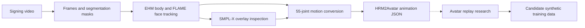

# Sign Language Avatar Augmentation

**面向手语合成数据研究的数字人动作处理与可视化工作流，基于 Taobao3D / HRM2Avatar。**

Research context: NYU Abu Dhabi AIR Lab, supervised by Yi Fang. The project explores how motion captured from real signing videos can be prepared for avatar replay, with the goal of creating more varied examples for sign-language recognition.

This repository is a portfolio fork of [Alibaba Taobao3D](https://github.com/alibaba/Taobao3D). The avatar and rendering foundations belong to their original authors. The original project introduction and publication links are preserved in [UPSTREAM.md](UPSTREAM.md).

## Research workflow



The final two stages describe the research direction. This README does not claim a completed recognition benchmark or a measured downstream accuracy gain.

## My contribution

My work connects signing-video tracking to avatar animation. I adapted custom videos to the EHM workflow, prepared frame/mask inputs and inspected SMPL-X overlays. I then implemented an EHM-to-HRM2Avatar converter and diagnostic scripts to address the differences between the tracking and animation representations. The converter maps SMPL-X body/hand and FLAME jaw/eye poses into **55 joint-rotation channels plus one pelvis-position channel**.

| Work | Ability demonstrated |
| --- | --- |
| Preparing video, frame and mask inputs | Building consistent data interfaces between vision components |
| Mapping body, hand, jaw and eye rotations into the avatar channel layout | Motion retargeting and integration of research systems |
| Correcting rotation-coordinate conventions, the EHM left-hand axis convention and SMPL-X mean-hand pose handling | Debugging geometric representations and model-specific pose semantics |
| Interpolating suspected tracking-failure frames, applying light smoothing and preserving quaternion sign continuity | Temporal motion processing and animation export |
| Inspecting SMPL-X overlays and comparing SMPL-X / HRM2Avatar skeletons and bone lengths | Visual diagnosis of hand/body alignment and skeleton differences |

## Implementation evidence and limits

The lab implementation includes the original and revised conversion scripts, a pipeline diagnostic, an old/new animation comparison and a skeleton visualization. The revised converter accepts an EHM output directory, a scene descriptor, an output path, frame rate and smoothing strength; it exports local rotations and pelvis position with animation tangents.

Two existing revised outputs were inspected structurally:

| Output | Frames | Channels | Final timestamp |
| --- | ---: | ---: | ---: |
| Signing sample 1 | 230 | 56 | 7.633333 s |
| Signing sample 2 | 252 | 56 | 8.366667 s |

These checks establish the exported format and sequence lengths. They do not establish visual fidelity or a recognition-accuracy improvement. The converter assumes a front-facing signer by zeroing the global/root rotation, uses a spine-rotation heuristic to flag suspected tracking failures, and does not export expression blendshapes. These choices need evaluation before applying the converter to broader motion datasets.

## What is available here

- [HRM2Avatar implementation and setup](HRM2Avatar/README.md): the upstream avatar/rendering foundation relevant to this research.
- [Dens3R](Dens3R/README.md): a separate upstream reconstruction project distributed in Taobao3D.
- This project overview and the preserved [upstream introduction](UPSTREAM.md).

The default branch currently contains the upstream foundation and this project documentation. The project-specific EHM preprocessing, conversion and diagnostic scripts are in the lab workspace and are **not included in this public snapshot**; neither are the signing-video datasets or generated tracking/animation outputs. The contribution description documents the research work; cloning this repository alone does not reproduce the full signing-video pipeline.

## Getting started

```bash
git clone https://github.com/yf2685-beep/sign-language-avatar-augmentation.git
cd sign-language-avatar-augmentation
```

Continue with the [HRM2Avatar instructions](HRM2Avatar/README.md) for supported platforms, dependencies, assets and rendering steps. Follow the upstream requirements for model/data access.

## Interview discussion points

- Why hand alignment deserves separate inspection in a signing workflow.
- How frame extraction, masks and coordinate conventions affect downstream tracking.
- Why hand-pose means and left/right conventions matter when transferring rotations between systems.
- Why quaternion sign continuity is necessary, and how smoothing can remove useful signing detail.
- How to distinguish a visually plausible overlay from evidence of useful training data.
- What additional evaluation would be needed before claiming better sign-language recognition.

## Attribution

Taobao3D and HRM2Avatar are upstream research projects by their respective authors. Preserve their licenses, citations and attribution when using the code or assets; see [UPSTREAM.md](UPSTREAM.md) and the component documentation.
